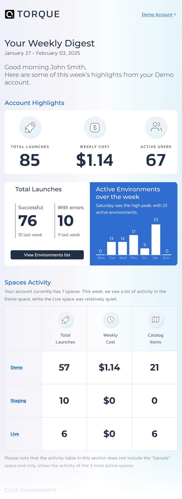

__Overview__

The Configuration page consolidates key system settings and administrative configurations for account management. This page replaces two older settings pages, streamlining access to critical configuration options

---

### 1. White Labeling

Customize the Torque interface with your organization's branding by uploading a custom logo. This ensures a **consistent and professional** look throughout the platform.

This feature allows you to:  
- Replace the default Torque logo across the system.  
- Upload three logo types: Favicon, Wide Logo, and Square Logo.  
  
**How to upload your logo**

1.  In **Admin > Configurations**, select **White Labeling**.
2.  Upload all three recommended logo types:

-   **Favicon** – Appears in the browser tab.
-   **Wide Logo** – This logo will appear in the header section of your website or application
-   **Square Logo** – This logo will appear in places where a square image is needed, such as social media profile pictures.

3. Confirm that your logo uploads successfully.

🔒  White Labeling is optionally available for **Enterprise plans only**.

---

### 2. Announcements

  
Use the **Announcements** feature to display **important messages across the platform** with a banner at the top of every page.  
  
This feature allows you to create and manage announcement banners to notify users about critical updates. You can:  
- Set banners for specific spaces or apply them globally.  
- Customize the message, and banner color.  
- Enable Maintenance Mode to prevent environment launches in selected spaces.

**How to set up an Announcement**

1.  In **Admin > Configurations**, select **Announcements**.
2.  Use the ‘Preview Mode’ toggle to see how your banner will eventually look like.
3.  Enter your message and customize the **banner color**.
4.  Choose specific **spaces** to display the announcement or apply it system-wide.
5.  Enable the **Maintenance Mode** if needed. This mode enables preventing selected spaces from launching new environments during your scheduled downtime.
6.  Save changes to instantly publish the announcement.

---

### 3. Audit Logs

Torque’s **Audit Logs** provide comprehensive tracking of key platform activities, helping you monitor user behavior, investigate security risks, and maintain compliance.  
Options include:  
- ElasticSearch: With built-in **Elastic Stack integration**, you can forward audit data for real-time analysis and reporting.  
- Torque Audit: Forward logs to Torque, and retain for 18 months..  
  
**How to set up an Audit Log destination**  
📖 Learn more about [Torque Audit](/governance/audit-log/audit-log-configuration)
  
info 🔒  Audit log integration is  available for **Enterprise plans only** and requires a specific licensing feature.

---

### 4. Copilot Settings

Turn on Torque's AI features and choose the AI engine that powers them. In **Admin > Configurations**, select **Copilot Settings**. The panel has two features.

**Torque Copilot (DocsBot)** – An AI chatbot that answers questions from the official Torque documentation. Use its toggle to turn it on or off for all users.

**Cloud Copilot** – AI assistance to create and customize blueprints, auto-generate descriptions, and resolve live environment errors, for example with **Get AI Insights** on a failed environment step. Cloud Copilot is subject to the [Torque MSA](https://www.quali.com/legal-torque-master-subscription-agreement/) and requires user consent. It must be enabled for your account; if it isn't, click **Send a Request** and Quali will contact you.

Cloud Copilot sends its AI data to the engine listed under **AI Provider**:

- **Torque AI**, hosted by Torque's OpenAI. No configuration is needed; when it is in use, the panel shows **Activated and applied**.
- **Your own AI model**. Click **Connect AI**, select **Connect Model**, and fill in the connection:
  - **Connection Name** – a unique name. It can't be changed after saving.
  - **Endpoint URL** – the full URL of the model's endpoint.
  - **Key** (optional) – create a new key or search for a stored one, then paste the **Key value**.
  - **Use your own agent** – reach the model through one of your agents instead of the Torque network, then select the **Agent**.
  - **Available Models** (optional) and **Embedding Model** – Copilot needs an embedding model to search the documentation.
  - **Set as Active Connection** – Copilot uses this connection's chat and embedding models.

  Click **Test Connection** to check the connection, then **Save**.

To switch engines later, open the ⋮ menu of a connection and select **Set as active**, or edit the connection.

<!-- REVIEW (2026-11-16): verified live in Admin > Configurations > Copilot Settings and the Connect AI dialog (closed with Cancel); the connection fields, Key value, Agent, models, and Set as active come from the frontend bundle. The classic page offered Torque's OpenAI, Azure OpenAI (GPT-4o deployment names), and OpenAI; the UI now has Torque AI or a generic model connection. Open questions for Yaniv: what the Torque Copilot (DocsBot) toggle controls now that the top-bar Copilot is the Torque AI assistant, and whether the classic Cloud Copilot panel in the blueprint designer still exists. The classic images docsbot.png, cloud_copilot_panel.png, and ai_insights.png were removed from this section. -->

---

### 5. SSO Login

Streamline authentication with Single Sign-On (SSO) integration.  
  
**How to Enable SSO Login**

1.  In **Admin > Configurations**, select **SSO Login**.
2.  To enable SSO, click ‘Send a Request’ to connect with an account manager.

- 📖 [How SSO Configuration Works](/admin-guide/sso)
  
info 🔒  SSO Login is optionally available for **Enterprise plans only**.

---

### 6. Email Reports  
Subscribe to the ‘Weekly Digest’, a summary email providing key account activity insights.  
Torque's weekly digest reports condense the most important information from a week's worth of data collected in Torque, making it easier for administrators to quickly understand the most critical developments.  
The Torque ‘Weekly Digest’ emails are being sent to administrators and will highlight:

-   Cloud usage
-   User activity
-   Environments usage
-   Cloud Cost
-   Top used IaC modules
-   Top contributors to the operation

Example:

  
**How to Enable Email Reports**

1.  In **Admin > Configurations**, select **Email Reports**.
2.  Toggle on the ‘Email Report’ toggle to subscribe to the ‘Weekly Digest’ email report
3.  Toggle off to unsubscribe  

---

### 7. Approval Requests

Control the visibility of the Approval Requests page. Approval policies will still apply.  
  
**How to Enable Approval Requests**

1.  In **Admin > Configurations**, select **Approval Requests**.
2.  Toggle the setting to **show or hide** the Approval Requests page.

:::tip __Important__
Notice that hiding the page does NOT prevent users from applying approval requests for launching, or extending environments.
:::

---

### 8. Resources Inventory

Choose which parts of the Resources Inventory are available in the account:

- **Cloud Resources**: discover the resources in your cloud accounts, codify unmanaged resources, and curate selected resources into managed Torque environments.
- **Custom Resources**: define and upload your own resource types and instances, so that blueprints can declare resource requirements and reserve resources while an environment runs.

If both are turned off, **Resources > Inventory** shows nothing and points you back to this page.

**How to configure the Resources Inventory**

1.  In **Admin > Configurations**, select **Resources Inventory**.
2.  Turn **Cloud Resources** and **Custom Resources** on or off.

📖 Learn more about the [Resources Inventory](/getting-started/Resources-Inventory) and [Custom Resources](/getting-started/Resources-Inventory/custom-resources).

---

### 9. Quick Launch

Enable your team to Quick Launch — this configuration skips the summary step and launches environments instantly.

When enabled by the account admin:
-> The 'Review Summary' step is removed.
-> You’ll see a single ‘Launch’ button for a quicker start.

**How to Enable Quick Launch**
1.	In **Admin > Configurations**, select **Quick Launch**.
2.	Toggle the setting **ON to show only the ‘Launch’** button, no ‘Review Summary’ option.
3.	Toggle the setting **OFF to show only the ‘Review Summary’**. Users will be able to launch only after reviewing the summary.

---

### 10. Experimental Features

Experimental Features give account administrators early access to upcoming capabilities in Torque that are still in development. These features are in a **beta** or **testing phase** and may not yet be fully supported or stable.

This settings gives **Torque administrators early visibility and hands-on access** to major upcoming features and UI changes—allowing them to explore, prepare, and influence what’s coming before it rolls out to all users.
 

**What You Need to Know**
- 🔬 **Experimental features are optional** and intended for **evaluation and feedback purposes only**.
- 🧪 These features may contain bugs or incomplete functionality. Use with caution in production environments.
- 👤 **Only the admin who enables an experiment** will see the changes. No other users in the account will be affected.
- 📆 Each experiment includes a defined **trial period** with a description of what’s new.
- 📩 Admins can provide feedback via:
  -> A **survey form** linked within the experiment.
  -> A **support ticket** submitted through the Torque support system.

  
**How to Use Experimental Features**
1.	In **Admin > Configurations**, select **Experimental Features**.
2.	Review the list of available features.
3.	Click the toggle next to an experiment to **enable or disable** the feature **for yourself only**.
4.	Try out the new feature and explore the changes.
5.	Submit feedback via the linked survey or by opening a support ticket.
 
 
**After the Experiment Period**

Once the experiment ends:
-	The feature will be **evaluated based on admin feedback**.
-	If approved, it will be officially released and made **available to all users** in the account.
-	You’ll receive updates in the product and via release notes.
 

🛠 **Note**: Enabling experimental features is a great way to influence Torque’s roadmap and help improve future releases.

info 🔒  Experimental Features are optionally available for **Enterprise plans only**.

  
