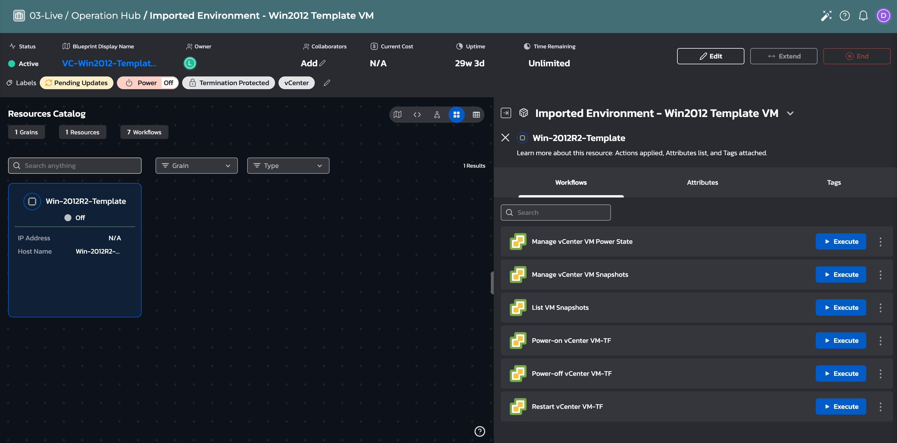
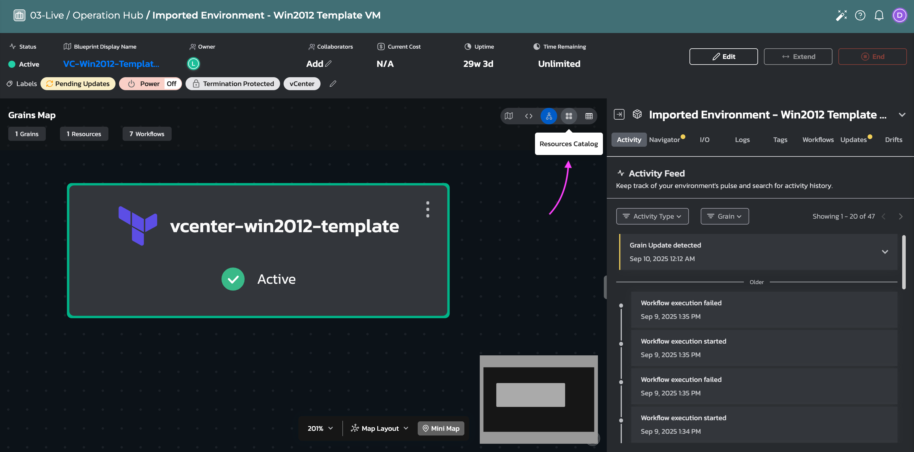
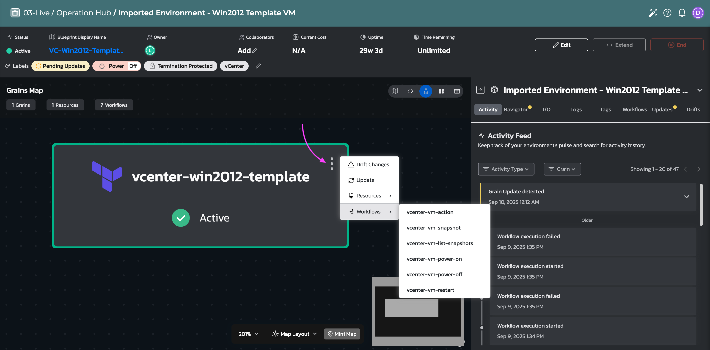

# Actions and Workflows

Torque gives you two ways to operate the resources of a running environment:

- **Actions** are one-off operations on a single resource, such as powering a virtual machine off or restarting it. You run them from the resource's card on the environment page.
- **Workflows** are automations defined in YAML that run on an environment, on its resources, or on the space. They can run on demand, on a schedule, or when an event happens, for example powering off every VM in an environment at 6 PM each day.

Both help you cut cloud spend, reduce the attack surface of idle resources, and keep environments under control without leaving Torque.

## Running an action on a resource

1. Go to **Environments** and open the environment.
2. On the **Overview** tab, find the card of the resource you want to operate.
3. Hover over the card. The actions available for that resource appear as icons in the card's bottom-right corner, for example **Power off** and **Restart** for a virtual machine.
4. Click the action. While it runs, the resource shows **In progress**.
5. To follow the run, open **Logs** or **Activity** in the panel on the right of the environment page.



The actions offered depend on the resource type. They include **Power on**, **Power off**, **Restart**, **Health Check**, and **Connect**. **Connect** opens a remote session to the resource; see [Remote Access](/environment-services/remote-access).

<!-- REVIEW (2026-11-12): verified live on 03-Live (Azure VM card: Power off and Restart icons on hover; resource details drawer has only Attributes and Tags; the grain menu on the Orchestration tab has only I/O and Source). No action was run, so whether a confirmation appears and exactly where progress shows (In progress on the card, Logs, Activity) come from the frontend bundle. Confirm with Yaniv. -->

## Running workflows on an environment

Workflows whose scope is the environment or one of its resources are listed on the environment page:

- The **Workflows** card on the **Overview** tab shows how many workflows apply, the executions in the last 7 days, the scheduled runs, the failed runs in the last 7 days, and the **Workflows Scope** split between **Environment** and **Resource** workflows.
- **Workflows** in the panel on the right lists them. Each row shows the workflow's trigger (**Manual**, **Cron**, or **Event**) and scope, its last 3 runs, and a **Run** button. Use **Search by workflow name** or **Filters** to narrow the list.



To run a workflow now, click **Run** on its row. The environment must be active. Expand a row to see its **Last execution**, **Last 3 executions**, **Next execution**, **Trigger**, **Scope**, and **Labels**, and to open **View all executions** or **Latest logs**.



Workflow executions also appear on the **Environments** page next to the environments. Workflows whose scope is the space are published to the catalog and started with **Execute**; see [Self-Service Catalog](/getting-started/self-service-catalog).

### Common workflow examples

- **Daily shutdowns**: power off all VMs in the environment every day at 6 PM.
- **Weekend scaling**: pause development Kubernetes clusters every weekend.
- **Cost optimization**: stop database instances outside business hours.
- **Maintenance windows**: restart resources during low-usage periods.

To create workflows and use the built-in actions (power on and off, restart, start and stop databases, pause and resume AKS and EKS clusters, and more) in them, see [Workflows Overview](/workflows/workflows-overview#torque-built-in-workflows) and [Workflows Use Cases](/workflows/workflows-use-cases).

## Debugging actions

For verbose output when you debug actions, add this [parameter](/admin-guide/params) at the account level:

```
SYSTEM_ACTIONS_VERBOSE_MODE=true
```

## Related Documentation

- [Environment Publishing](/environment-services/environment-publishing) - Learn about publishing and managing environments
- [Remote Access](/environment-services/remote-access) - Set up direct access to environment resources
- [Cost Management](/environment-services/Cost) - Optimize your cloud spending
- [Drift Detection](/environment-services/drift-and-update) - Handle configuration drift
- [Scheduled Environments](/environment-services/scheduled-environments) - Automate environment lifecycle
