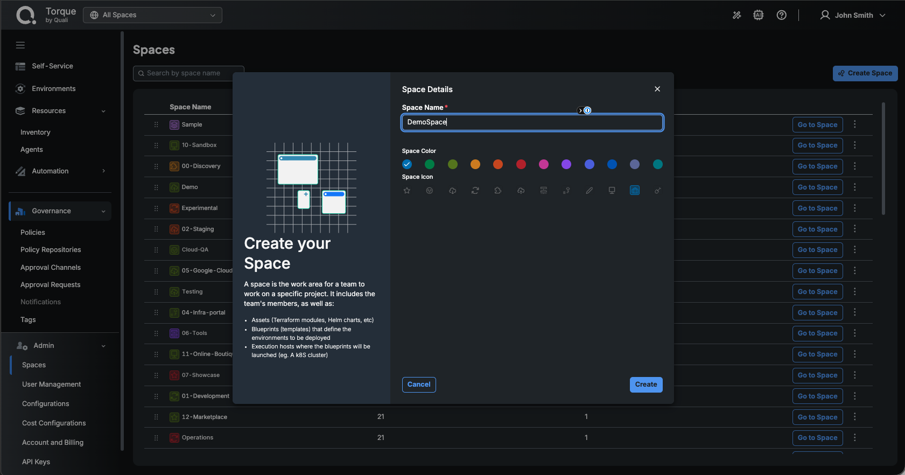
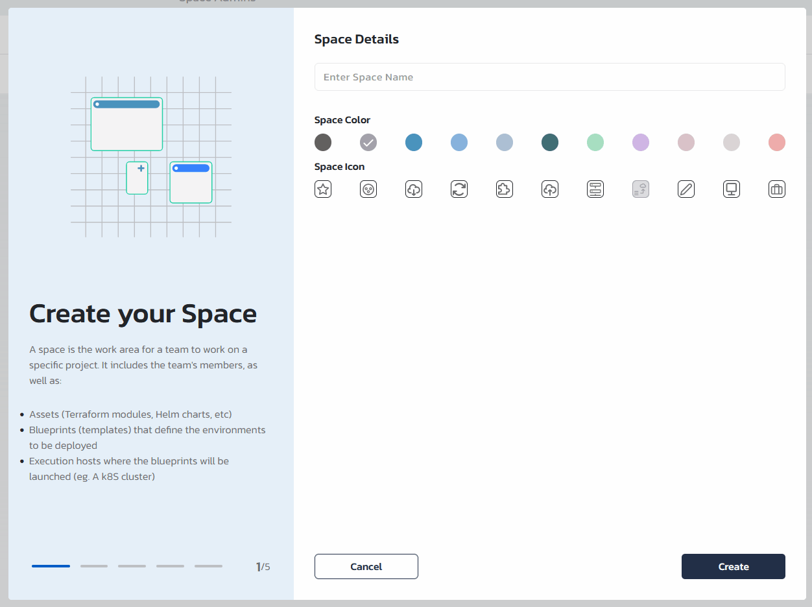

__Torque Control Plane__ offers centralized orchestration and management for Terraform and other IaC tools. In this guide, we will go over some of Torque basic features allowing quick onboarding of Terraform modules into the platform, standardization of Terraform automation using blueprints and securing deployment process using tagging, policies and RBAC.

In this quick-start guide, we will cover the following topics:
1. Create a new Torque Space
2. Connect a Git repository and let Torque discover the automation assets in it
3. Choose the agent that runs your Terraform and give it your cloud credentials
4. Launch a blueprint and get access to the deployed resources in the newly created environment

> NOTE: This guide will focus on AWS and Azure Terraform workloads, [click here](/overview/supported-platforms.md) for more information about Torque supported platform.

## Step #1: Create a space
:::info
__Spaces__ are logically separate areas that contain an association to one or more agents, asset and blueprint repositories, and a set of permitted users. Spaces can be used to logically separate teams, projects, or even development lifecycle stages, and allow the relevant end-users, administrators, and blueprint designers to access only the relevant blueprints and environments.
:::

1. To create a new space, use one of the following methods:
   * Expand the **Admin** section at the bottom of the left sidebar, click **Spaces**, and click **Create Space**. This is the account space management page where you can create, edit, and delete spaces.
   * Open the space selector at the top of the page and click **Create a new Space**.

2. In the **Create your Space** dialog, fill in the **Space Details**: the **Space Name**, a **Space Color**, and a **Space Icon**, then click **Create**.

   Torque switches to the new space, opens its (empty) **Self-Service** catalog, and immediately opens the **Connect a repository** dialog described in Step #2. If you close that dialog, the space still exists and you can connect the repository later from **Automation > Repositories**.

   The space name, icon, and color can always be changed later from **Admin > Spaces** using the space's **⋮** menu.
> 


## Step #2: Connect a repository
Now that you have a new space configured, we will connect a repository to the space and let Torque discover the automation assets in it. We recommend using your own repository hosted in one of the supported Git providers. For on-prem/hosted versions of the supported version control systems, see [Repository Setup](/admin-guide/source-control/source-control-github) and [Self Hosted Repositories](/admin-guide/source-control/Self%20Hosted%20Repositories/overview).

1. In the **Connect a repository** dialog that opens after the space is created (or, later, in your space under **Automation > Repositories** by clicking **Add Repository**), select your Git provider: **BitBucket**, **GitHub**, **GitLab**, **Azure DevOps**, **CodeCommit**, or **CloudShell**.
2. In the **Repository details** step, enter the **Repository URL**, a **Repository Name**, and optionally a **Branch**.
3. Under **Credentials**, choose **Select from Credentials Store** and pick existing credentials for this provider, or choose **Create New Credentials** and enter a **Credentials Name** and the provider's access token. For the provider-specific fields, see [Repository Setup](/admin-guide/source-control/source-control-github).
4. Click **Connect**. Torque scans the repository and shows a **Successfully connected to** summary with the number of assets that were discovered and are now managed in the space. Blueprint YAML files under the repository's `blueprints` folder are added to the space automatically.
> Note: you can always use [this](https://github.com/QualiTorqueDemo/ProductionDemos) example repository with pre-existing automation assets and blueprints.

5. Click **Explore in IaC Assets Page** (or go to **Automation > Automation Inventory** and open the **IaC Assets** tab). Each discovered asset is listed with its **Type**, **Self-Service** and **Building Block** toggles, **Status**, **IaC Local Path**, and **Repository Name**. Toggle **Self-Service** for the asset you want to launch. Torque wraps the asset in a blueprint behind the scenes and adds it to the Self-Service catalog. For details, see [Blueprint Design](/blueprint-designer-guide/blueprint-quickstart-guide).

> 

## Step #3: Choose an agent and add cloud credentials
Terraform runs on a Torque **agent**. A new space has no agent yet: its **Resources → Agents** page shows **Connect an Agent** ("To eventually launch environments, an Agent is required"). Either:

* **Use an existing agent**: switch to **All Spaces**, go to **Resources → Agents**, open the agent's **⋮** menu, select **Manage Spaces**, click **Add**, and select your space.
* **Install your own agent**: in the space, go to **Resources → Agents**, click **New Agent**, and follow [Install an Agent on your Kubernetes Cluster](/agent/Install-and-connect-self-hosted-agent). At the end of the wizard, click **Associate to Space**.

The agent also needs your **cloud credentials** to provision the environment in your AWS or Azure account. There are two ways to provide them:

* **Credentials store (recommended)**: Store the credentials once in **Automation > Credentials** and reference them from a blueprint through a `type: credentials` input and the grain's `authentication` block. See [Credentials](/admin-guide/credentials) and [Credentials Input Type](/blueprint-designer-guide/blueprints/blueprints-yaml-structure#credentials-input-type).
* **Environment variables in the blueprint YAML**: Author a blueprint YAML file under the `blueprints` folder of your repository that references the Terraform module as a grain, and expose the credentials as inputs mapped to environment variables, as shown below. The blueprint is added to the space automatically once the repository is synced. For the blueprint structure, see [Blueprint Design](/blueprint-designer-guide/blueprint-quickstart-guide#option-b-create-a-multi-asset-blueprint-in-your-source-control-repository).

<!-- REVIEW (2026-11-02): walked live in the demo account (space cj-test-delete-me, repository ProductionDemos). The classic guide edited the auto-generated blueprint YAML inside Torque; in next, assets wrapped through the Self-Service toggle have no editable YAML, so the guide now points to the Credentials store or to a repository blueprint. Confirm with Yaniv that this is the intended quick-start path. -->

### AWS authentication 
The agent needs your __AWS credentials__ to provision the environment in your AWS account. In your blueprint YAML, expose them as inputs and map them to environment variables so they are provided when a new environment is launched.

1. Add the following inputs under the input section of the blueprint:

    ```yaml
    inputs:
      AWS_ACCESS_KEY:
        type: string
      AWS_SECRET_KEY:
        type: string
    ```

2. Add the following environment variables under the env-var section of the blueprint. For more information about generating AWS credentials, see the [AWS documentation](https://docs.aws.amazon.com/cli/latest/userguide/cli-configure-envvars.html)

    ```yaml
    env-vars: 
      - AWS_ACCESS_KEY: '{{ .inputs.AWS_ACCESS_KEY }}'
      - AWS_SECRET_KEY: '{{ .inputs.AWS_SECRET_KEY }}'
    ```


### Azure authentication 
The agent needs your __Azure credentials__ to provision the environment in your Azure account. In your blueprint YAML, expose them as inputs and map them to environment variables so they are provided when a new environment is launched.


1. Add the following inputs under the input section of the blueprint:
    ```yaml
    inputs:
      ARM_CLIENT_ID:
        type: string
      ARM_CLIENT_SECRET:
        type: string
      ARM_SUBSCRIPTION_ID:
        type: string
      ARM_TENANT_ID:
        type: string
    ```
2. Add the following environment variables under the env-var section of the blueprint. For more information about generating Azure credentials, see the [Azure documentation](https://learn.microsoft.com/en-us/azure/developer/terraform/authenticate-to-azure)
    ```yaml
    env-vars: 
      - ARM_CLIENT_ID: '{{ .inputs.ARM_CLIENT_ID }}'
      - ARM_CLIENT_SECRET: '{{ .inputs.ARM_CLIENT_SECRET }}'
      - ARM_SUBSCRIPTION_ID: '{{ .inputs.ARM_SUBSCRIPTION_ID }}'
      - ARM_TENANT_ID: '{{ .inputs.ARM_TENANT_ID }}'        
    ```

## Step #4: Launch an Environment

At this point, you have done the following:
* Created a new space
* Connected an asset repository and discovered its assets
* Chosen an agent and a way to provide cloud credentials

 🚀🚀 You are now ready to launch your first environment!  🚀🚀

1. Make sure the blueprint or IaC asset is published: in **Automation > Automation Inventory**, the **Self-Service** toggle of the item must be on (inside a blueprint, the **Self Service** button reads **Hide from Catalog** while it is published). See [Publishing to the Self-Service Catalog](/blueprint-designer-guide/blueprint-publishing).
2. Go to **Self-Service** and click **Launch** on the blueprint card.
3. Specify the environment's name, duration, tags, and inputs. Some of the inputs may be the credentials or agent required to deploy, as described in Step #3.
4. Optionally assign collaborators to the environment. While everyone in the space has "read" permission to its environments, only the environment's owner and collaborators can perform actions that change the environment: extend or end the environment, reconcile or update resource changes, and so on. When launching the environment, the new owner/collaborators receive a notification email if you have [Notifications](/admin-guide/notifications) configured in the space.
5. Finally, click __Launch__.
6. Wait until the environment is active and use it as needed. URLs to the environment's applications are typically provided as outputs - these can be found in the environment's __Quick Access__ links.
7. Check out the __Resources__ tab to get details about your environment's resources. Use this tab to understand what assets each grain spun up, get connection details to specific resources, and more.
