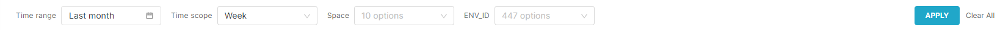
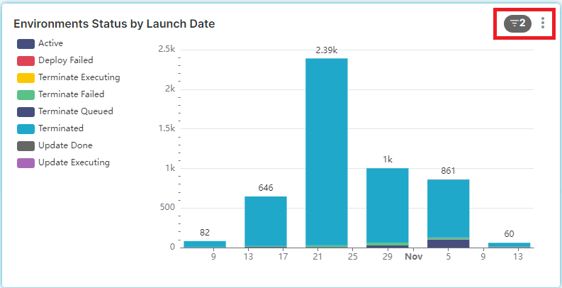
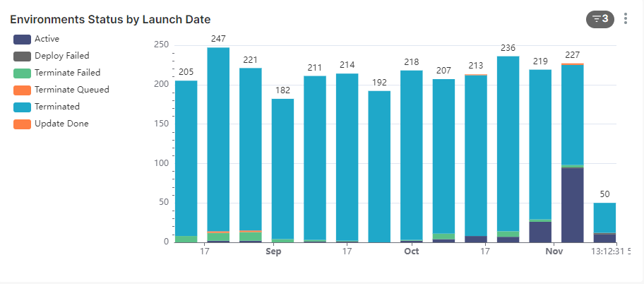
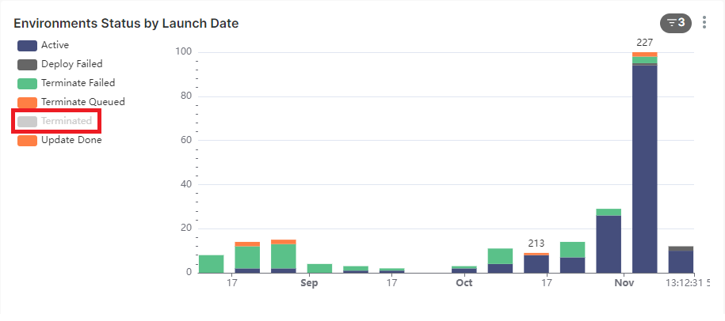
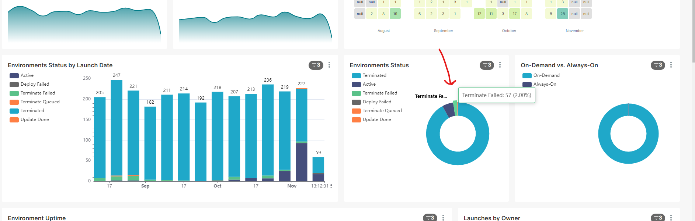
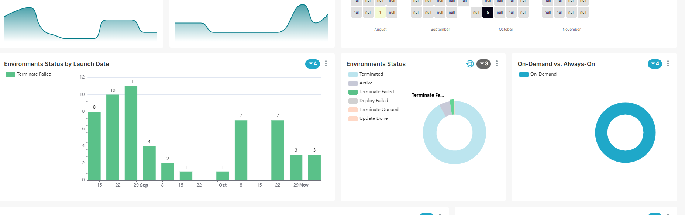
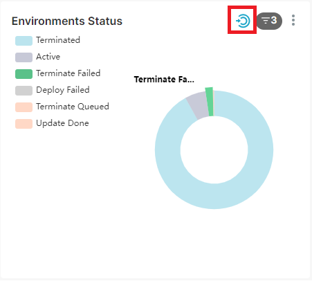

This article describes the general utilities and options for using any report in Torque.

## Top Filter ##

On the top of every report you can find the **filter**. 

> 

- **Time range** controls the total time frame that will be presented in the report.
- **Time scope** controls the grouping of events into smaller buckets of time.
- **Space** allows you to filter a specific space. The entire data in the report will be filtered. This is relevant only to account level reports. Space level reports are already filtered by the space.
- **ENV_ID** allows you to focus on a single environment throughout the report.

Click **Apply** to update the report with your selection, or **Clear All** to reset the filters. On the **Inventory Utilization** tab, the filters are **Time range**, **Time grain**, and **Resource type**.

## Chart Options ##

On the top right corner of every chart you will find the chart options:
> 

- The left one shows what this chart is filtered by right now
- The ellipsis menu on the right allows you to take actions on the data such as refresh it, view as table, share and download.

## Filtering by Legend Items ##

Clicking on an item in the legend will filter it **out** and re-scale the chart according to the remaining legend items. You can filter out multiple legend items.
For example, clicking **Ended** in the legend of the following chart filters out all ended environments and shows only the ones that have not ended.

>  
> 

To clear the legend filter, click again on the legend item.

## Cross Filtering ##

Cross filtering on a chart will impact the entire report.
The way to achieve cross filtering is by clicking on the **value** in the graph which you want to filter by.
The chosen value will be applied as a filter across the entire report.

For example, if you want to filter the entire report by a specific environment status (Released):

> 

Clicking the **Released** segment of the **Environments Status** chart (11 environments) filters the entire report to these 11 environments:

> 

Note the cross filter sign now next to the chart filters. Hover over it to see which charts the cross filter applies to:

> 

To clear the cross filter, click on the cross filter sign. 

## The Environments Table ##

At the end of each report you can find the environments table.
The environments are the main entity in Torque, and this table can be used to drill into the details of interesting data. From the environments table you can directly access each environment to investigate it.

